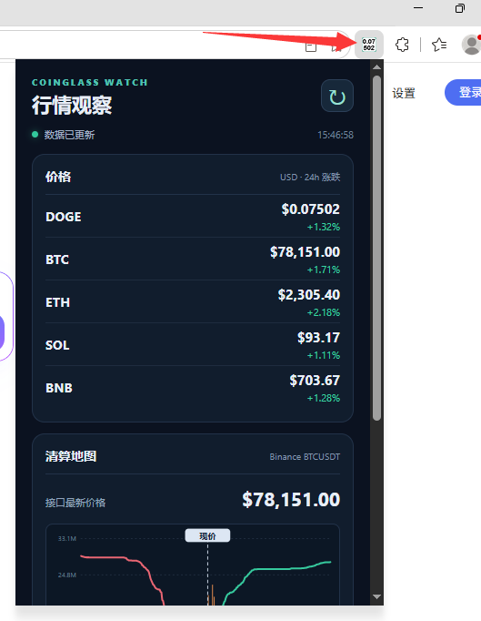
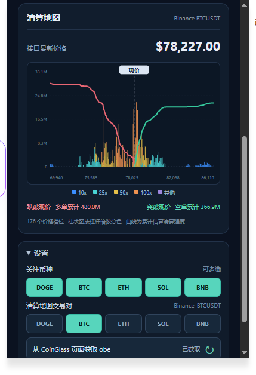

# CoinGlass Watch 浏览器扩展

一个用于在浏览器工具栏查看加密货币行情的开源扩展。点击图标可查看关注币种的价格、24 小时涨跌幅，以及所选交易对的清算地图。项目基于 Chrome Manifest V3，适用于 Chrome 和 Edge。

> 本项目为社区制作，与 CoinGlass 没有官方关联。数据来自 CoinGlass 网页使用的接口，接口可能随时调整。

## 功能

- **工具栏价格图标**：默认显示 DOGE 价格。小数价格分两行显示，图标采用白底黑字；悬停可查看完整价格。
- **行情弹窗**：显示 DOGE、BTC、ETH、SOL、BNB 等关注币种的美元价格和 24 小时涨跌幅。
- **清算地图**：按价格档位展示估算清算强度，用颜色区分 10x、25x、50x、100x 杠杆，并绘制多空累计曲线与现价标记。
- **快捷设置**：通过按钮切换关注币种和 Binance/USDT 清算地图交易对。
- **自动获取 `obe`**：默认不内置请求头值。扩展会从 CoinGlass 页面发出的 API 请求中读取 `obe`；设置中也可手动触发重新获取。
- **定时更新**：浏览器运行时每 10 秒尝试刷新；弹窗顶部可立即刷新。

## 安装

1. 下载或克隆本仓库。
2. 打开 Chrome 的 `chrome://extensions` 或 Edge 的 `edge://extensions`。
3. 开启「开发者模式」，点击「加载已解压的扩展程序」，选择仓库中的 [`extension/`](extension/) 文件夹。
4. 将扩展固定到工具栏。

修改源码后，在扩展管理页点击「重新加载」。扩展第一次运行可能会打开一个未激活的 CoinGlass 标签页，用于获取 `obe` 请求头。如果设置中显示「未获取」，可打开 CoinGlass 页面并点击「从 CoinGlass 页面获取 obe」重试。

## 权限与数据

扩展仅对 `www.coinglass.com` 和 `capi.coinglass.com` 配置站点权限。`webRequest` 权限用于读取 CoinGlass 页面发往其 API 的 `obe` 请求头；`tabs` 和 `scripting` 用于在需要时借助 CoinGlass 页面发起请求。关注币种、交易对及自动获取的 `obe` 保存在浏览器本地存储中。

价格是接口请求时的快照，清算地图表示**估算清算强度**，并非已经发生的爆仓金额。浏览器或系统休眠、网站限流、接口参数及加密方式变化，都可能导致刷新延迟或数据暂时不可用。

## 开发与验证

扩展源码位于 [`extension/`](extension/)。无需构建步骤，修改后重新加载扩展即可。使用 Node.js 22+ 运行本地编解码测试：

```bash
node verify-extension-codec.js
```





## 许可证

本项目采用 [MIT License](LICENSE)。


